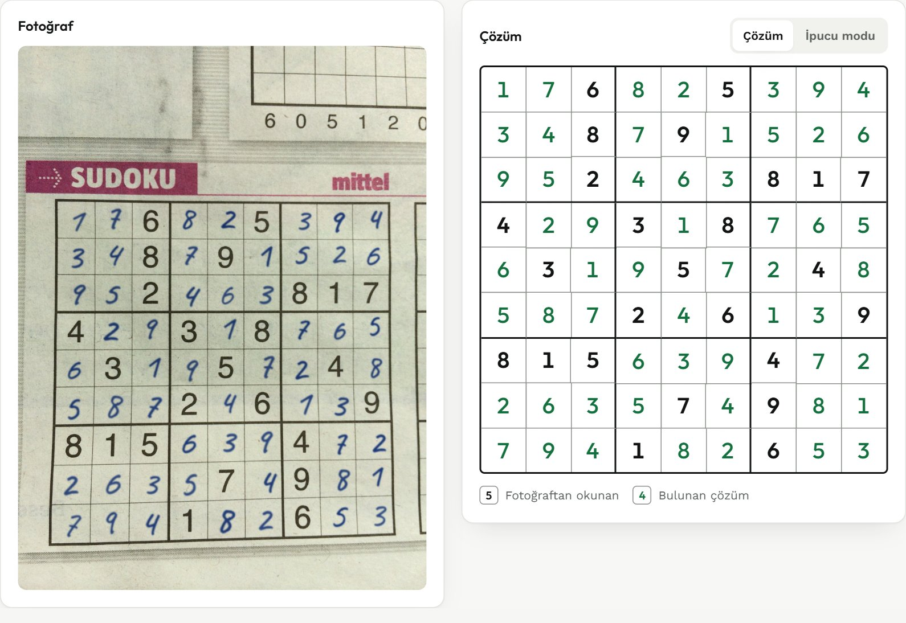
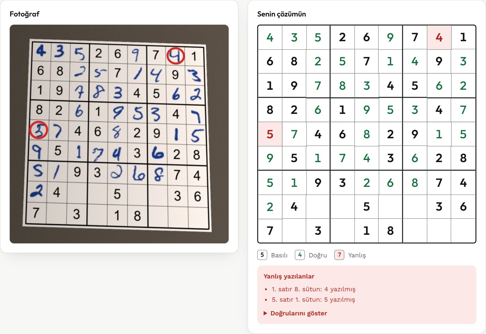

<div align="center">

# Sudoku Çözücü

**Fotoğraftaki sudokuyu okur, çözer ve çözümü kağıda kalemle yazılmış gibi fotoğrafın üstüne çizer.**<br>
**Kalemle doldurduğun sudokuyu da kontrol eder: yanlış yazdığın rakamları bulur.**

[](https://sudoku-cozucu.onrender.com)
[](LICENSE)


[**Canlı dene**](https://sudoku-cozucu.onrender.com) ·
[Özellikler](#özellikler) ·
[Kurulum](#kurulum) ·
[Nasıl çalışır?](#nasıl-çalışır) ·
[Doğruluk](#doğruluk) ·
[Gizlilik ve güvenlik](#gizlilik-ve-güvenlik)

</div>

<table>
  <tr>
    <td width="50%" align="center">
      
      <br><sub><b>Çözme:</b> çözüm, fotoğraftaki kağıda kalemle yazılmış gibi çizilir</sub>
    </td>
    <td width="50%" align="center">
      
      <br><sub><b>Kontrol:</b> yanlış yazılan rakamlar kırmızı halkayla işaretlenir</sub>
    </td>
  </tr>
</table>

> [!NOTE]
> Canlı deneme ücretsiz bir sunucuda çalışır: bir süre kullanılmazsa uyur, ilk açılış yaklaşık bir dakika
> sürer ve bir fotoğrafın işlenmesi birkaç saniye alabilir. Elinde sudoku yoksa giriş ekranındaki
> örneklerle tek tıkla deneyebilirsin.

Çalışırken derin öğrenme kütüphanesi gerektirmez: görüntü işleme OpenCV ile, basılı rakam tanıma
bilgisayardaki yazı tiplerinden üretilen sentetik veriyle eğitilen bir k-NN sınıflandırıcıyla yapılır.
El yazısı için küçük bir sinir ağı PyTorch ile eğitilip ONNX olarak projeye konmuştur; OpenCV'nin
`cv2.dnn` modülüyle çalıştırılır.

## Özellikler

**Fotoğraftan çözme**

- **Eğik, yan ya da ters çekilmiş fotoğraflar:** perspektif düzeltme ve otomatik yön bulma
- **Kalemle yazılmış gibi çözüm:** rakamlar ızgaranın fotoğraftaki boyutunda, her biri biraz farklı açı
  ve kalem baskısıyla, kağıdın gölgesi ve ışığı korunarak çizilir
- **Kurallarla hata düzeltme:** emin olunmadan okunan rakamlar sudoku kurallarına göre düzeltilir ve
  turuncu gösterilir
- **Yanlış çözüm göstermemeye çalışır:** okunan tahtanın tek bir çözümü olduğu doğrulanır; yoksa çözüm
  yerine uyarı verilir ve okunamayan rakam tahtada elle düzeltilip tekrar çözdürülebilir
- **Fotoğraf kalite önerileri:** okuma başarısız olursa olası sebebi (bulanıklık, küçük ızgara, karanlık,
  parlama) ve ne yapılacağını söyler

**Kalemle doldurulmuş sudokuyu kontrol etme**

- El yazısı her rakam için "doğru", "yanlış" ya da "kontrol et" der; ağ okuduğundan emin değilse
  "yanlış" demez
- Yanlışlar fotoğrafın üstünde kırmızı halkayla, tahtada kırmızıyla işaretlenir ve "22 doğru, 2 yanlış,
  11 boş" gibi özetlenir; doğru cevaplar istenirse ayrıca açılır

**Öğrenmek için**

- **İpucu modu ve zorluk derecesi:** çözümü hamle hamle açar; her hamlede hangi tekniğin (tek aday,
  gizli tek, açık çift, kutu-satır kesişimi, gizli çift, açık üçlü, X-Wing) neden işe yaradığını anlatır.
  Bulmacaya, gereken en zor tekniğe göre Kolay / Orta / Zor / Şeytani der. Oynatıcıyla çözüm
  kendiliğinden ilerler (hız seçimi ve kaydırıcıyla atlama).
- **"Nasıl gördüm?" paneli:** fotoğrafın adım adım nasıl işlendiğini gösterir (siyah-beyaz görüntü,
  puanlanan ızgara adayları, düzleştirilmiş tahta, silinen çizgiler, okunan rakamlar ve güven durumu)

**Arayüz ve kullanım**

- Sürükle-bırak, dosya seçme ya da `Ctrl+V` ile ekran görüntüsü yapıştırma; telefonda doğrudan fotoğraf çekme
- Tek tıkla örnek görseller: gazete fotoğrafı, yan çekilmiş fotoğraf, kalemle doldurulmuş sayfa
- Sonuç görselini indirme; telefonda "Paylaş" düğmesiyle paylaşım menüsü
- Açık ve koyu tema, telefona uygun düzen
- Komut satırı ve canlı kamera modu

## Kurulum

Python 3.12 ya da üstü gerekir.

```
pip install -r requirements.txt
python app.py
```

Ardından tarayıcıda <http://127.0.0.1:5000> adresini aç.

Bağımlılıkların sürümleri sabittir; yeni bir kütüphane sürümü uygulamayı sessizce bozmasın.
Linux sunucu için `requirements-sunucu.txt` (pencere kütüphanesi gerektirmeyen OpenCV ve gunicorn),
modeli yeniden eğitmek için `requirements-egitim.txt` kullanılır.

**Komut satırı:**

```
python cli.py                   # dosya seçme penceresi açılır
python cli.py foto.jpg          # sonucu foto_cozum.jpg olarak kaydeder
python cli.py *.jpg --gosterme  # toplu çözüm, pencere açmadan
python cli.py --kamera          # canlı kamera (çıkış: q)
```

<details>
<summary><b>Arayüzü geliştirmek</b> (React + TypeScript + Vite)</summary>

<br>

Arayüzün kaynak kodu `frontend/` klasöründedir. Derlenmiş hali `static/` klasöründe hazır gelir;
sadece kullanmak için Node.js gerekmez. Arayüzü değiştirmek için:

```
cd frontend
npm install
npm run dev     # canlı geliştirme: http://localhost:5173 (app.py ayrıca çalışıyor olmalı)
npm run build   # değişiklikleri static/ klasörüne derler
```

`static/` klasörü derleme çıktısıdır, elle düzenlenmez.

</details>

<details>
<summary><b>Docker ve Render'da yayın</b></summary>

<br>

```
docker build -t sudoku-cozucu .
docker run -p 7860:7860 sudoku-cozucu      # http://127.0.0.1:7860
```

İmaja sadece çalışmak için gereken dosyalar girer; uygulama root olmayan bir kullanıcıyla, gunicorn
ile çalışır (`gunicorn.conf.py`; işçi sayısı `WEB_CONCURRENCY`, port `PORT` ortam değişkeniyle ayarlanır).

`render.yaml`, Render'ın ücretsiz planında Docker web servisini tanımlar: Frankfurt, tek işçi;
512 MB bellek sınırıyla en ağır isteklerde ~275 MB ölçüldü. render.com → New → Blueprint → bu depo
seçilir; GitHub'a her gönderimde yeniden yayınlanır. Ücretsiz planda servis 15 dakika istek gelmezse
uyur, ilk açılış yaklaşık bir dakika sürer.

</details>

## Nasıl çalışır?

1. **Izgarayı bulma** (`vision.find_grid`): Görüntü uyarlamalı eşiklemeyle siyah-beyaza çevrilir,
   konturlar bulunur. Her büyük dörtgen düzleştirilir ve iç çizgilerin gerçekten 1/9 aralıklarla durup
   durmadığı puanlanır. Böylece kağıt kenarı, tek bir 3x3 kutu ya da sayfadaki küçük "dünkü çözüm"
   ızgarası asıl bulmacayla karışmaz. Kenarı kopuk ızgaralar için konturun dış bükey zarfı kullanılır;
   bulanık fotoğraflarda kesik kesik kalan ince çizgiler için eşiklenmiş görüntünün hafifçe
   kalınlaştırılmış halinden de aday üretilir.
2. **Düzleştirme:** Izgara 450x450'lik bir kareye çevrilip 81 hücreye bölünür.
3. **Rakam okuma** (`vision.find_digits`, `vision.read_board`): Hücre sınırlarına yakın, hücre boyunda
   düz çizgiler (ızgara çizgileri) morfolojik açmayla silinir; hücrenin ortasındaki uzun çizgiler
   korunur, çünkü büyük yazılmış bir 1'in ya da 7'nin gövdesi olabilir. Hücre sınırlarına körü körüne
   güvenilmez: tüm tahtada rakam boyutundaki parçalar bulunur ve merkezlerinin düştüğü hücreye atanır.
   Böylece köşeler biraz kaymış ya da sayfa hafif kıvrık olsa da rakamlar kaybolmaz. Rakamlar 28x28'e
   normalize edilir ve en yakın örneğe göre sınıflandırılır. Tahta 4 yönde okunur, rakamların en net
   tanındığı yön seçilir.
4. **Çözme** (`solver.solve_unique`): Bitmask ile çalışan, her adımda en az seçenekli hücreyi seçen (MRV)
   geri izlemeli (backtracking) bir çözücü. Arama ikinci bir çözüm için de sürer: birden fazla çözüm
   çıkması bir rakamın okunamadığını gösterir.
5. **Kurallarla düzeltme** (`vision.correct_and_solve`): Tahta çözülemezse, sınıflandırıcının emin olmadığı
   hücrelerde (1. ve 2. tahmini birbirine yakın olanlar) 2. ve 3. tahminler en olasıdan başlayarak
   denenir. Bir değişiklik ancak bulmacayı tek çözümlü yapıyorsa kabul edilir. Emin okunmuş rakamlara
   hiç dokunulmaz: birden çok hata varken onları değiştirmek tutarlı ama yanlış bir tahta üretebiliyor.
6. **Geri yansıtma** (`vision.draw_handwritten`): Çözüm el yazısı bir yazı tipiyle, ızgaranın fotoğraftaki
   gerçek boyutunda çizilir ve ters perspektif dönüşümüyle fotoğrafa yerleştirilir. Her rakam biraz farklı
   açı, boyut ve kalem baskısıyla yazılır. Mürekkep kağıdın üstüne yapıştırılmaz, kağıdı koyulaştırır
   (çarpma karışımı); böylece kağıdın dokusu, gölgesi ve ışığı korunur. Canlı kamera modunda görünürlük
   için yeşil dijital rakamlar kullanılır.

<details>
<summary><b>Kalemle doldurulmuş sudokuyu kontrol etme</b> (<code>kontrol.py</code>)</summary>

<br>

1. **El yazısı okuma:** Basılı rakamlar için kullanılan ikili maske ince el yazısını kalınlaştırıp
   delikleri dolduruyor (8 → 1 gibi). El yazısı ağına bunun yerine gri mürekkep yoğunluğu verilir, sadece
   rakamın kendi maskesinin çevresinden; böylece ızgara çizgisi parçaları ağa gitmez.
2. **Sinir ağı** (`egit_el_yazisi.py`): 4 evrişim katmanlı küçük bir ağ, MNIST el yazısı rakamlarıyla
   eğitilir. Fotoğrafa benzetmek için döndürme, eğme, kalın/ince kalem, bulanıklık, soluk mürekkep ve
   gürültü eklenir; MNIST'te az bulunan Türk/Avrupa yazımları (ortası çizgili 7, bayraklı 1) için ek
   örnekler üretilir. Model, el yazısı eklenmiş gazete fotoğraflarıyla seçilir.
3. **Basılı mı el yazısı mı:** Bir rakamın yazı tipine uzaklığı tek başına yetmiyor (bulanık fotoğrafta
   basılı rakamlar da uzaklaşıyor). Bunun yerine aynı fotoğraftaki basılı rakamlara *göre* uzaklık,
   yükseklik ve çizgi kalınlığı farkına bakan bir lojistik regresyon kullanılır.
4. **Bulmacayı kurma:** Rakamlar en güvenilirden başlanarak ipucu yapılır: önce yazı tipi okuyucusuyla
   el yazısı ağının aynı okuduğu rakamlar (basılı rakamları ikisi de tanır), sonra basılı olma ihtimaline
   göre. Çelişki çıkaran rakam ipucu yapılmaz; tek çözüm bulununca durulur. Böylece basılı sanılıp yanlış
   okunan bir el yazısı rakam bulmacayı bozmaz.
5. **Hüküm:** Ağ çözümdeki rakama en az %10 olasılık veriyorsa "doğru"; vermiyorsa ve okuduğu rakamdan en
   az %98 eminse "yanlış"; ikisi de değilse "kontrol et". Basılı sayılıp çözümle çelişen bir rakam da ağ
   tarafından değerlendirilir: basılı rakam çözümle çelişemez, büyük ihtimalle basılı sanılan bir el
   yazısıdır.

Modeli yeniden eğitmek için (PyTorch sadece burada gerekir, ~20 dk CPU):

```
pip install -r requirements-egitim.txt
python veri_indir.py
python egit_el_yazisi.py
```

</details>

<details>
<summary><b>Basılı rakam tanıma verisi</b> (<code>digits.py</code>)</summary>

<br>

Windows yazı tipleriyle (116 yazı tipi) 1-9 rakamları çizilir. Döndürme, kalınlık değişimi ve düşük
çözünürlük/bulanıklık ile çoğaltılarak 7162 örnek elde edilir. Hazır veri `digits_data.npz` dosyasında
gelir; yeniden üretmek için `python digits.py` (Windows gerekir).

</details>

## Doğruluk

[wichtounet/sudoku_dataset](https://github.com/wichtounet/sudoku_dataset) içindeki, telefonla çekilmiş
gerçek gazete fotoğraflarıyla ölçülmüştür:

| | Geliştirmede kullanılan 40 fotoğraf | Hiç görülmemiş 40 fotoğraf |
|---|:---:|:---:|
| Izgara bulundu | 40 | 40 |
| Doğru çözüldü | 36 | 37 |
| **Yanlış çözüm gösterildi** | **0** | **0** |

Ayarlar yalnızca ilk sette yapıldı; ikinci set ezber olup olmadığını kontrol etmek için ayrı tutuldu.
Çözülemeyen fotoğraflarda program tahmin yürütmez, "okunamadı" der; eksik rakam arayüzde elle düzeltilip
çözüm alınabilir.

**Kalemle doldurulmuş sudoku kontrolü:** aynı gazete fotoğraflarının boş hücrelerine sonradan el yazısı
eklenmiş halleriyle (`veri/karisik/`) ve 5 gerçek tükenmez kalem fotoğrafıyla (`veri/dogal/`) ölçülmüştür:

| | Geliştirme (40) | Doğrulama (40) | Gerçek kalem (5) |
|---|:---:|:---:|:---:|
| Bulmaca doğru çözüldü | 39 | 40 | 5 |
| Yanlış çözüm | 1 | 0 | 0 |
| El yazısı rakam | 1983 | 2073 | 205 |
| → "doğru" | 1963 | 2047 | 200 |
| → "kontrol et" | 14 | 23 | 4 |
| → **doğru yazılmışa "yanlış" (yanlış alarm)** | **6** | **3** | **1** |

Yanlış yazılmış rakam benzetimiyle (fotoğraf başına 3 rakam), yanlışların yaklaşık %90'ı "yanlış",
%6-7'si "kontrol et" olarak işaretlendi.

> [!IMPORTANT]
> Dürüst notlar: Bulmacayı kurma sırası doğrulama setindeki hatalara bakılarak düzeltildi; o set artık
> tamamen "görülmemiş" sayılmaz. Gerçek kalem seti sadece 5 fotoğraf ve ayarlarda kullanıldı. Geliştirme
> setindeki tek yanlış çözümde, el yazısı bir rakamı iki okuyucu da %99 güvenle yanlış okuyor.

<details>
<summary><b>Ölçümü tekrarlamak</b></summary>

<br>

Fotoğrafları indir (yaklaşık 18 MB, `veri/` klasörüne) ve ölçümü çalıştır:

```
python veri_indir.py
python benchmark.py veri/gelistirme
python benchmark.py veri/dogrulama
python benchmark.py veri/karisik/dogrulama --kontrol
python benchmark.py veri/dogal --kontrol
```

Kendi fotoğraf setinle de ölçebilirsin: her `foto.jpg` dosyasının yanında doğru cevabı içeren bir
`foto.dat` olmalı (2 satır başlık ve ardından 9 satır rakam).

</details>

## Gizlilik ve güvenlik

**Gizlilik:** Yüklenen fotoğraf sadece sonucu hazırlamak için bellekte işlenir; diske yazılmaz, saklanmaz.

- Flask'ın altyapısı (Werkzeug) 500 KB'tan büyük yüklemeleri normalde geçici dosyaya aktarır; bu kapatıldı
  (`app.MemoryRequest`).
- `tests/test_gizlilik.py` bunu üç yoldan doğrular: Python'un denetim kancasıyla her dosya yazma ve geçici
  dosya girişimini yakalar, proje klasörünü işlem öncesi ve sonrası karşılaştırır, sistemin geçici
  klasöründe OpenCV'nin geçici dosyalarını izler.
- Sunucu kaydına sadece zaman, istenen sayfa yolu, sonuç ve süre yazılır; IP adresi ve görsel yazılmaz.
- Arayüz yazı tipleri dahil her şey bu sunucudan gelir; ziyaretçinin bilgileri üçüncü taraflara gitmez.

**Güvenlik:**

- Sadece JPG, PNG ve WEBP kabul edilir; biçim ve çözünürlük (en fazla 50 megapiksel) görsel açılmadan,
  dosya başlığından kontrol edilir. OpenCV bazı biçimleri (ör. HDR) çözmek için veriyi diske geçici dosya
  olarak yazıyor; bu biçimler OpenCV'ye hiç verilmez. Yükleme en fazla 20 MB.
- Kullanıcının gönderdiği tahta ve ızgara köşeleri doğrulanır; görselin dışındaki köşeler reddedilir.
  Çözücüde adım sınırı vardır: en zor bilinen bulmacalar da 1 saniyenin altında yanıtlanır.
- Tarayıcı güvenlik başlıkları: sayfa sadece kendi dosyalarını yükler ve çalıştırır
  (Content-Security-Policy), başka sitelere adres bilgisi gönderilmez, başka siteler sayfayı çerçeve
  içinde gösteremez.
- Beklenmeyen hatalarda kullanıcıya iç ayrıntı gösterilmez; sadece `static/` klasörü dışarıya açıktır.
- Bağımlılıklarda bilinen açık yok (`pip-audit`, `npm audit`; 2026-10-17). Sürümler sabit.

## Testler

```
python -m pytest
```

111 test: çözücü, sentetik eğik fotoğraflar, site ekran görüntülerine benzeyen sentetik görseller
(`tests/images/uret.py`), gerçek bir kalem fotoğrafıyla kontrol modu, web API'si, komut satırı, gizlilik
ve güvenlik.

Tarayıcı testleri (`tests/test_browser.py`) arayüzü gerçek bir tarayıcıda uçtan uca dener: görsel yükleme,
düzeltme ve ipucu modları, kontrol modu, örnek görseller, paylaşma, telefon görünümü, hata durumları,
güvenlik başlıklarının arayüzü engellemediği ve sayfanın başka sunuculara istek göndermediği. Kurulu
Microsoft Edge'i kullanır; Edge yoksa `python -m playwright install chromium` gerekir. Playwright kurulu
değilse bu testler atlanır.

## Proje yapısı

```
app.py                  web sunucusu (Flask)
vision.py               ızgara bulma, rakam okuma, çözümü çizme
digits.py               sentetik veri üretimi ve k-NN rakam tanıma
solver.py               sudoku çözücü (geri izleme, tek çözüm doğrulaması)
ipucu.py                insan gibi çözen çözücü: ipuçları ve zorluk derecesi
kontrol.py              kalemle doldurulmuş sudokuyu kontrol etme
adimlar.py              "Nasıl gördüm?" paneli için açıklamalı ara görseller
kalite.py               fotoğraf kalite kontrolü (bulanıklık, ızgara boyutu, karanlık, parlama)
cli.py                  komut satırı ve kamera modu
egit_el_yazisi.py       el yazısı ağını eğitir (el_yazisi.onnx, el_yazisi_tur.json)
benchmark.py            gerçek fotoğraflarda doğruluk ölçümü
veri_indir.py           ölçümde kullanılan fotoğrafları indirir
frontend/               web arayüzünün kaynak kodu (React + TypeScript + Vite)
static/                 derlenmiş arayüz (npm run build çıktısı)
fonts/                  el yazısı yazı tipi Caveat ve yazı tiplerinin lisans metinleri (SIL OFL)
tests/                  otomatik testler
docs/                   README ekran görüntüleri ve GitHub önizleme görseli
requirements*.txt       bağımlılıklar: yerel, sunucu, model eğitimi
gunicorn.conf.py        Linux sunucu ayarları (işçi sayısı, zaman aşımı, IP'siz erişim kaydı)
Dockerfile              Linux sunucu imajı
render.yaml             Render'da yayın ayarları
LICENSE                 MIT lisansı
```

## Sınırlamalar

- Çözme modu yalnızca basılı rakamları okur; el yazısı sadece kontrol modunda okunur.
- El yazısı kontrolü az sayıda gerçek kalem fotoğrafıyla denendi; farklı el yazılarında doğruluk değişebilir.
- Çok kıvrık sayfalarda ızgara düz bir dörtgen olmadığı için kenardaki hücreler kayabilir.
- Büyük fotoğraflar işlemeden önce en uzun kenarı 1280 px olacak şekilde küçültülür: tüm ayarlar ve
  ölçümler bu boyutta yapıldı, daha fazla çözünürlük okumayı iyileştirmiyor (büyütülmüş fotoğraflarla
  denendi). İndirilen sonuç görseli de bu boyuttadır.
- Kurallarla düzeltme çok bulanık bir fotoğrafta nadiren yanlış çözüm üretebilir: ölçüm fotoğraflarının
  3 kat büyütülmüş hallerinde 80 fotoğrafta 1 kez görüldü (orijinal boyutlarda hiç görülmedi).
- Rakam veri setini yeniden üretmek Windows yazı tipleri gerektirir (hazır veri her sistemde çalışır).

## Lisans ve atıflar

Projenin kodu [MIT lisansı](LICENSE) ile yayınlanmıştır. Projeyle gelen diğer parçaların kendi lisansları
vardır:

| Parça | Kaynak | Lisans |
|---|---|---|
| `fonts/Caveat.ttf` (çözümü çizen el yazısı yazı tipi) | The Caveat Project Authors | SIL Open Font License 1.1 (`fonts/OFL.txt`) |
| Arayüz yazı tipleri Outfit ve Work Sans (`static/assets/`) | The Outfit Project Authors, The Work Sans Project Authors | SIL Open Font License 1.1 (`fonts/OFL-Outfit.txt`, `fonts/OFL-WorkSans.txt`) |
| `el_yazisi.onnx` (el yazısı rakam ağı) | [MNIST](http://yann.lecun.com/exdb/mnist/) (Yann LeCun, Corinna Cortes, Christopher J.C. Burges) ile eğitildi; veri setinin kendisi projede yok, eğitimde indirilir | MNIST: CC BY-SA 3.0 |
| `tests/images/kalem.jpg`, `docs/cozum.jpg`, örnek görseller `gazete.jpg` ve `yan.jpg` (`frontend/public/ornekler/`), önizleme görselleri `frontend/public/og.jpg` ve `docs/sosyal-onizleme.jpg` ve `veri_indir.py`'nin indirdiği fotoğraflar | [wichtounet/sudoku_dataset](https://github.com/wichtounet/sudoku_dataset) (Baptiste Wicht, Jean Hennebert) | [CC-BY-4.0](https://creativecommons.org/licenses/by/4.0/); `docs/cozum.jpg` ve önizleme görselleri üstüne çözüm çizilerek değiştirildi |
| Örnek görsel `kalem.jpg` (`frontend/public/ornekler/`) ve onu içeren `docs/kontrol.jpg` ile önizleme görselleri | Basılı bulmacanın boş hücrelerine MNIST test kümesinden (eğitimde kullanılmayan) gerçek el yazısı rakamlar yerleştirilerek bilgisayarda üretildi | MNIST: CC BY-SA 3.0 |
| `digits_data.npz` (basılı rakam örnekleri) | Windows yazı tiplerinden çizilmiş 28x28 rakam görüntüleri | Yazı tipi dosyalarının kendisi dağıtılmaz |
